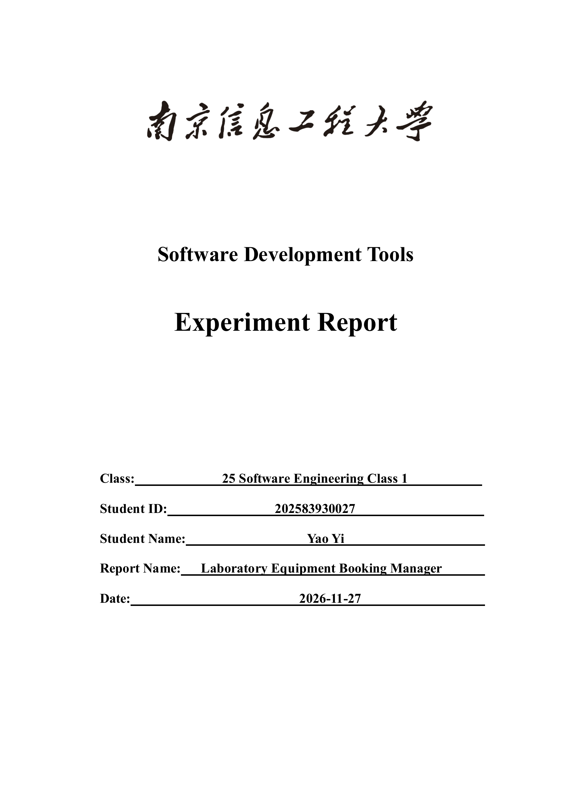
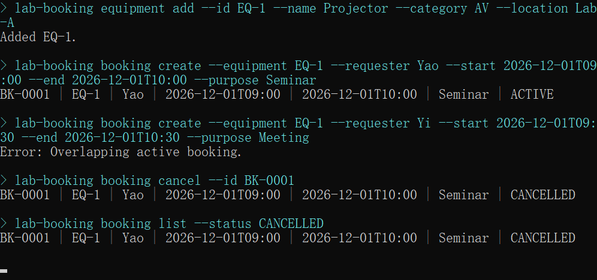
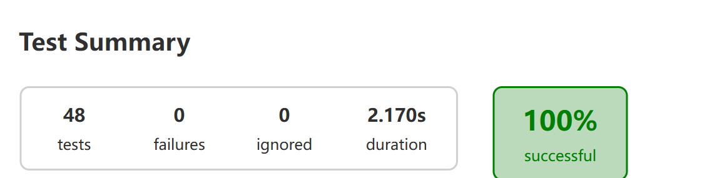
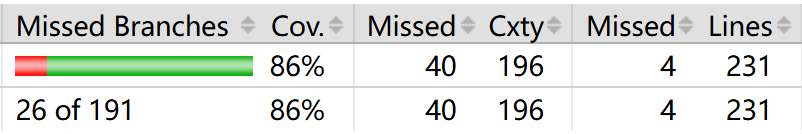
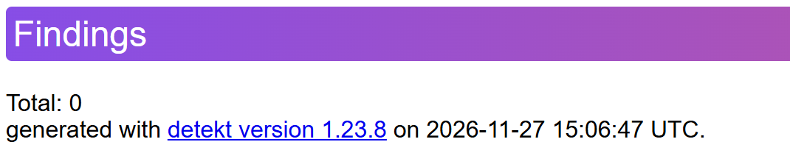
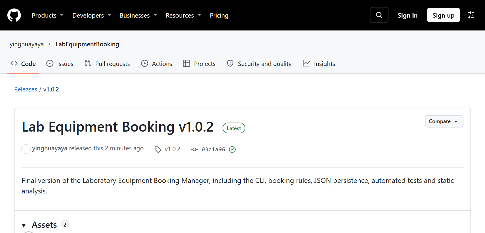

<!-- PDF export: run pandoc REPORT.md -f gfm -t html5 -s --metadata pagetitle="Laboratory Equipment Booking Manager" --css=report-assets/print.css --embed-resources -o report.html, then print the HTML to A4 PDF at 100% with CSS page size, background graphics and no browser headers or footers. -->

# Laboratory Equipment Booking Manager

## 1. Experiment Goal

The Laboratory Equipment Booking Manager lets a requester search and inspect equipment, reserve a time slot and cancel a booking. It prevents overlapping reservations and preserves booking history between command-line runs.

## 2. Experiment Steps

### Application flow

`Main.kt` starts `CliApplication` and returns its exit code. `CommandParser` checks the arguments before `CliApplication` dispatches the command. For a data command, `BookingStore` loads a `BookingService` under a file lock. `BookingService` applies the catalog and reservation rules, and `BookingStore` saves a successful update.

### Catalog and booking rules

The catalog supports adding, listing, showing and searching for equipment. A `HashMap` keyed by equipment ID detects duplicates and locates a record directly. A second `HashMap` indexes bookings by their generated IDs. Both provide average O(1) lookup. Equipment with booking history cannot be deleted because the recorded reservations still refer to it.

Each item has a `TreeMap` of active start times. A proposed slot can conflict only with the booking immediately before or after its start. The service checks `floorEntry` and `ceilingEntry` in O(log n) time for n active bookings of that item. The half-open interval `[start, end)` allows a booking to start exactly when another ends. Cancellation frees the slot and keeps the record.

### Saving a reservation

The JSON snapshot holds the equipment catalog, booking history and next booking number. A `FileChannel` lock on a sibling file covers the transaction. The store writes a temporary file beside the database and requests atomic replacement, with a regular replacement as fallback. On load, it validates the records and rebuilds the active schedules. Invalid JSON or conflicting reservations stop the command before the file is replaced.

### Commands and CLI demonstration

| Module | Commands |
| --- | --- |
| Equipment | add, list, show, search, delete |
| Booking | create, list, cancel |
| General | help (also --help) |

Creating a booking requires an equipment ID, requester, start, end and purpose. Listing bookings accepts optional equipment and status filters. The parser rejects missing values, unknown options and invalid ISO local dates and times. An unknown ID, a reversed time range or an overlapping slot also produces an error on `stderr` and exit code 1.

Figure 1 shows five commands using a temporary database. The second booking request starts at 09:30, during an existing 09:00–10:00 reservation for the same projector.

*Figure 1. CLI demonstration of booking, conflict rejection and cancellation.*

The competing request produced a diagnostic and did not consume a booking number. After cancellation, the temporary JSON file contained one equipment item, one cancelled reservation (`BK-0001`) and a next sequence of 2. The usual database was outside this demonstration directory.

### Build and toolchain

On Windows, run `.\gradlew.bat clean build` from the project directory. The wrapper fixes the Gradle version, so the build uses 8.12.1 even on a machine with a different global installation.

| Tool | Version |
| --- | --- |
| JDK | 17 |
| Gradle Wrapper | 8.12.1 |
| Kotlin | 2.1.21 |
| kotlinx.serialization JSON | 1.8.1 |
| JUnit Jupiter | 5.12.2 |
| JaCoCo | 0.8.13 |
| Detekt | 1.23.8 |

I chose JDK 17 to give the local build and GitHub Actions the same compilation and runtime baseline. Kotlin’s static types keep the equipment and booking rules explicit with little boilerplate. With kotlinx.serialization, the store can write these typed records to JSON and restore them without maintaining a separate field-by-field mapping.

JUnit Jupiter lets the domain, parser and CLI tests run in one suite. Parameterized tests check several invalid inputs against the same rule. JaCoCo shows which lines and branches the tests exercised. Detekt adds Kotlin-specific checks to the same Gradle build, so GitHub Actions can verify compilation, tests and analysis on pull requests to main and pushes to main.

### Windows build troubleshooting

An incomplete JDK download initially failed its checksum. Resuming the download and checking its SHA-256 supplied a usable JDK. Later, JUnit discovery failed under a Windows path containing Chinese characters. Running the launcher with the native JDK encoding fixed the worker classpath.

### Verification results

All 48 JUnit tests passed, with zero failures and zero skips. The suites covered the catalog (7), booking rules (8), persistence (6), command parsing (23) and CLI execution (4). They exercise adjacent and overlapping slots, cancellation, restart and corrupt-input handling.

*Figure 2. JUnit summary showing 48 passing tests.*

The test task runs JUnit and finalizes with `jacocoTestReport`. JaCoCo recorded 4 missed lines out of 231 and 26 missed branches out of 191. The HTML table rounds branch coverage to a whole percent.

*Figure 3. JaCoCo covered 227/231 lines (98.3%) and 165/191 branches (86.4%).*

The check task depends on detekt. Static analysis returned zero findings without a baseline or suppressions.

*Figure 4. Detekt reports zero findings.*

### Git workflow and release

Main is the integration branch. Each feature was developed on its own branch and submitted through a pull request. GitHub Actions ran the clean Gradle build on Ubuntu with JDK 17. Each of the four feature PRs passed before it was merged into main.

- [PR #1 — Equipment Catalog](https://github.com/yinghuayaya/LabEquipmentBooking/pull/1)

- [PR #2 — Booking Rules](https://github.com/yinghuayaya/LabEquipmentBooking/pull/2)

- [PR #3 — JSON Persistence](https://github.com/yinghuayaya/LabEquipmentBooking/pull/3)

- [PR #4 — CLI and Testing](https://github.com/yinghuayaya/LabEquipmentBooking/pull/4)

*Figure 5. GitHub Release “Lab Equipment Booking v1.0.2”.*

[GitHub repository](https://github.com/yinghuayaya/LabEquipmentBooking)  |  [Release v1.0.2](https://github.com/yinghuayaya/LabEquipmentBooking/releases/tag/v1.0.2)  |  [PR #8 – release documentation](https://github.com/yinghuayaya/LabEquipmentBooking/pull/8)  |  [Tag v1.0.2](https://github.com/yinghuayaya/LabEquipmentBooking/tree/v1.0.2)

[Assessed release commit (03c1a96)](https://github.com/yinghuayaya/LabEquipmentBooking/commit/03c1a96b63f5d3f989999c98fb24e19b432a02a9)

## 3. Conclusion

Separate feature branches let me review one decision at a time. For example, the booking-rules PR shows why comparing the two neighbouring start times is enough. The adjacent-slot test is important: changing a strict inequality to an inclusive one would reject a booking that starts exactly when another ends.

The Windows test-discovery failure showed me that the same JDK version can still behave differently when a path is encoded differently. A passing Ubuntu build alone would have missed that problem. For persistence, the most useful test checks that damaged data survives a failed load. A coverage count shows which code ran. The assertion checks what happened to the file.

### References

1.  [Kotlin Gradle configuration](https://kotlinlang.org/docs/gradle-configure-project.html)

2.  [Gradle Wrapper](https://docs.gradle.org/8.12.1/userguide/gradle_wrapper.html)

3.  [kotlinx.serialization](https://github.com/Kotlin/kotlinx.serialization)

4.  [JUnit 5 User Guide](https://docs.junit.org/5.12.2/user-guide/)

5.  [JaCoCo Gradle Plugin](https://docs.gradle.org/8.12.1/userguide/jacoco_plugin.html)

6.  [Detekt compatibility](https://detekt.dev/docs/introduction/compatibility/)

### Academic assistance disclosure

OpenAI Codex assisted with implementation, testing, documentation and repository operations, including preparation of this report. The test and coverage figures come from the preserved build reports. The screenshots show the running application, its reports and the published release.
